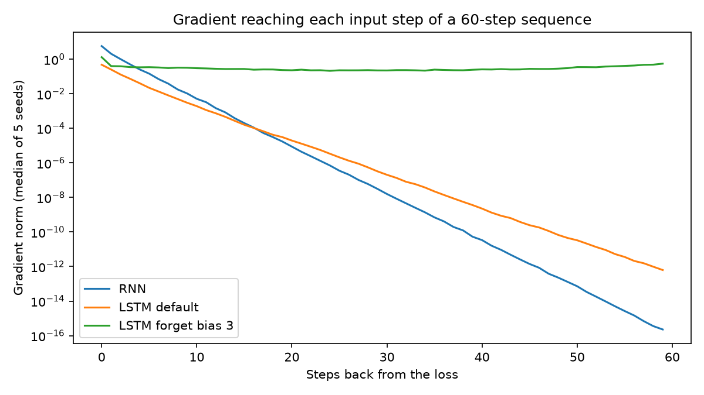

# What Recurrence Can and Cannot Remember

Measuring gradients through time and comparing recurrent cells on a delayed-recall task.

The label is given at step 0 and the model has to report it at the last step. Every later step is noise, so chance is 0.25. The task, model and training loop come from `lab04_starter.py`, unchanged.

## Setup

```bash
cd Lab-4
python3.12 -m venv .venv
source .venv/bin/activate
pip install -r requirements.txt
```

## Run

```bash
python lab04_starter.py   # check the environment, should print about 1.0
python Lab4.py            # every table below, saves figures/gradient_through_time.png
```

## Prediction

I expect clipping to make no difference for the plain RNN at length 30. All three seeds should stay near chance (0.25) with clipping on and with it off.

My gradient measurement shows the plain RNN's gradient 29 steps back is about 3.1e-08, against 5.8 at the last step. The label is 29 steps back from the loss, so almost no gradient reaches it. Clipping only shrinks gradients that are too big. It can't make a vanished gradient bigger, so I don't think turning it off or on will change anything.

## Results

### Benchmark

Starter defaults for every run: hidden 32, 600 updates, batch 64, Adam lr 3e-3, clipping 1.0.

| Config | Length | Seed 0 | Seed 1 | Seed 2 | Mean |
|---|---|---|---|---|---|
| RNN | 10 | 1.000 | 1.000 | 0.495 | 0.832 |
| LSTM default | 10 | 1.000 | 1.000 | 1.000 | 1.000 |
| LSTM forget bias 3 | 10 | 1.000 | 1.000 | 1.000 | 1.000 |
| GRU default | 10 | 1.000 | 1.000 | 1.000 | 1.000 |
| GRU update bias 3 | 10 | 1.000 | 1.000 | 1.000 | 1.000 |
| RNN | 30 | 0.248 | 0.251 | 0.264 | 0.254 |
| LSTM default | 30 | 0.248 | 0.251 | 0.255 | 0.251 |
| LSTM forget bias 3 | 30 | 1.000 | 1.000 | 1.000 | 1.000 |
| GRU default | 30 | 0.241 | 0.257 | 0.254 | 0.251 |
| GRU update bias 3 | 30 | 1.000 | 1.000 | 1.000 | 1.000 |
| RNN | 60 | 0.250 | 0.240 | 0.233 | 0.241 |
| LSTM default | 60 | 0.249 | 0.251 | 0.254 | 0.251 |
| LSTM forget bias 3 | 60 | 1.000 | 1.000 | 1.000 | 1.000 |
| GRU default | 60 | 0.248 | 0.249 | 0.240 | 0.246 |
| GRU update bias 3 | 60 | 1.000 | 1.000 | 1.000 | 1.000 |

The plain RNN failed on seed 2 even at length 10. At 30 and 60, everything at default initialization stays at chance.

To check the gate bias, I printed `bias_ih + bias_hh` for every gate block. With `gate_bias=3`, only `[32:64]` was exactly 3.0, which is the forget gate in the LSTM and the update gate in the GRU. The other blocks kept their small random values.

### Gradients

Loss on the last step of 60 only, hidden 32, batch 16, 8 features, median over 5 seeds.

| Model | 0 back | 9 back | 29 back | 59 back |
|---|---|---|---|---|
| RNN | 5.8e+00 | 1.0e-02 | 3.1e-08 | 2.3e-16 |
| LSTM default | 4.8e-01 | 3.0e-03 | 3.3e-07 | 6.3e-13 |
| LSTM forget bias 3 | 1.3e+00 | 3.2e-01 | 2.3e-01 | 5.6e-01 |



### Fixes

LSTM forget-gate bias at length 30:

| Forget bias | Seed 0 | Seed 1 | Seed 2 | Mean |
|---|---|---|---|---|
| 0 | 0.247 | 0.251 | 0.258 | 0.252 |
| 1 | 0.495 | 0.496 | 1.000 | 0.664 |
| 2 | 1.000 | 1.000 | 1.000 | 1.000 |
| 3 | 1.000 | 1.000 | 1.000 | 1.000 |

Plain RNN at length 30:

| Clipping | Seed 0 | Seed 1 | Seed 2 | Mean |
|---|---|---|---|---|
| On (1.0) | 0.248 | 0.251 | 0.264 | 0.254 |
| Off | 0.248 | 0.251 | 0.264 | 0.254 |

My prediction was right. The two rows are identical because the total gradient norm never went above 1.0 in any update (max 0.435 over 600 updates), so the clip never did anything.

### Timing

`nn.LSTM(64, 128)`, batch 32, forward and backward, best of 3.

| Length | Time | Per step |
|---|---|---|
| 50 | 0.0084s | 0.168 ms |
| 100 | 0.0162s | 0.162 ms |
| 200 | 0.0286s | 0.143 ms |
| 400 | 0.0707s | 0.177 ms |

I also ran the LSTM with forget bias 3 at length 200: 0.251, 0.250 and 0.245, back at chance.

## Conclusion

- Gates alone didn't help. The default LSTM and GRU failed at 30 and 60 steps, the same as the plain RNN, because their gradient vanishes too (6.3e-13 at 59 back for the LSTM).
- Initialization made the gates work. Starting the gate open kept the gradient at 0.56 even 59 steps back, and every seed went from chance to 1.000.
- Clipping changed nothing. The gradient was vanishing, not exploding, so it never got big enough to clip.
- Limit 1, recurrence is sequential: time grows linearly with length because each step waits for the one before it. Direct connections let every position be computed at the same time.
- Limit 2, everything goes through one fixed-size state: the open-gate LSTM solved 60 steps but was at chance at 200. Direct connections let the last step read step 0 in one hop instead of through 199 rewrites of the hidden state.
