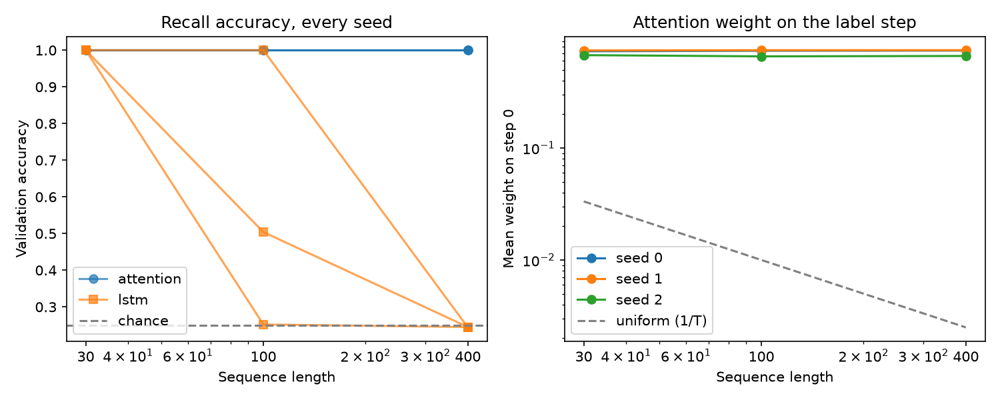
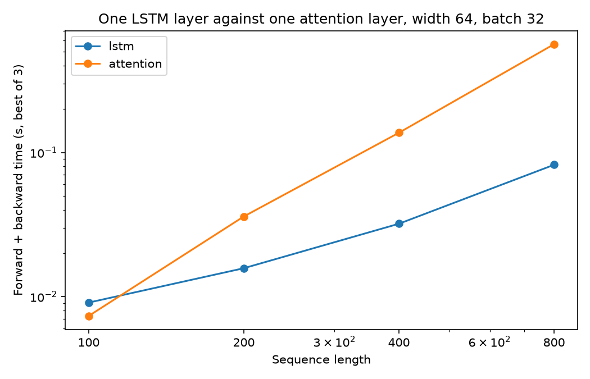

# Attention Against Recurrence

Attention built from scratch, then tested against recurrence, positions and normalization on small tasks with known answers.

Both tasks come from `lab05_starter.py`, unchanged. Delayed recall: the label is at step 0 and the rest is noise (chance 0.25). Order task: say whether token 1 comes before token 2 (chance 0.50). Every cell uses seeds 0, 1 and 2.

## Setup

```bash
cd Lab-5
python3.12 -m venv .venv
source .venv/bin/activate   # Windows: .venv\Scripts\activate
pip install -r requirements.txt
```

## Run

```bash
python lab05_starter.py   # environment check, about 1.0 on both tasks
python Lab5.py            # every table below, saves both figures
```

`Lab5.ipynb` has the same code with outputs. It covers four pieces:

1. My `scaled_dot_product_attention` and `MultiHeadAttention`, checked against PyTorch.
2. Recall at 30, 100 and 400 steps, attention readout against an LSTM with forget bias 3.
3. The order task with no, learned and sinusoidal positions, trained on 16 and then on mixed lengths.
4. 12-block stacks (post-norm, post-norm with warmup, pre-norm), then timing an LSTM against one attention layer.

## Prediction (written before running the mixed-length training)

Trained on 16 only, learned got 0.603 to 0.623 at length 32 and sinusoidal got 0.629 to 0.748.

**Learned:** a small improvement at 32, around 0.7 to 0.8. Lengths 8, 16 and 24 only train rows 0 to 23, so rows 24 to 31 stay random. About 44% of length-32 sequences have a marker there, and I expect those to be close to a coin flip. Lower again at 48.

**Sinusoidal:** a bigger improvement at 32, possibly above 0.9. Positions 24 to 31 still have defined values that follow the same pattern as the trained ones. Lower at 48, since those positions are further from training.

## Results

### Verification

| Check | Match | Max diff |
|---|---|---|
| Function, no mask (5 queries, 7 keys) | True | 3.6e-07 |
| Function, causal mask (6 steps) | True | 3.6e-07 |
| Module, self-attention | True | 1.8e-07 |
| Module, causal self-attention | True | 1.8e-07 |
| Module, cross-attention (6 queries, 9 context steps) | True | 9.1e-08 |

- The function asserts on every call that each row of weights sums to 1 and that masked weights are exactly 0.
- Three broken versions all fail the same comparison: softmax over the wrong axis, mask applied after the softmax, and heads split in the wrong order.
- Parameters at `d_model` 32: 4224 for 1, 2, 4 and 8 heads, because the heads split the same four 32 x 32 projections instead of adding new ones.
- Shuffling the input shuffles the output the same way.

### Recall

| Model | Length | Seed 0 | Seed 1 | Seed 2 | Mean |
|---|---|---|---|---|---|
| Attention | 30 | 1.000 | 1.000 | 1.000 | 1.000 |
| LSTM forget bias 3 | 30 | 1.000 | 1.000 | 1.000 | 1.000 |
| Attention | 100 | 1.000 | 1.000 | 1.000 | 1.000 |
| LSTM forget bias 3 | 100 | 0.252 | 1.000 | 0.504 | 0.585 |
| Attention | 400 | 1.000 | 1.000 | 1.000 | 1.000 |
| LSTM forget bias 3 | 400 | 0.245 | 0.244 | 0.245 | 0.245 |

Attention weight on step 0:

| Length | Seed 0 | Seed 1 | Seed 2 | Uniform (1/T) |
|---|---|---|---|---|
| 30 | 0.730 | 0.742 | 0.674 | 0.033 |
| 100 | 0.738 | 0.746 | 0.658 | 0.010 |
| 400 | 0.741 | 0.746 | 0.663 | 0.0025 |



The weight on step 0 doesn't drop as the sequence gets longer. With seed 0 at length 100, no other step gets more than 0.0032. When I moved the label to a random step, accuracy stayed 1.000 and the weight followed it, so the readout finds the label by content. The LSTM classifies from its last hidden state only, so the label has to make it through every step after it.

This doesn't show attention handling long-range dependencies in general, because the label can be found without its position.

### Positions

Trained on 16:

| Positions | Seed 0 (16 / 32) | Seed 1 (16 / 32) | Seed 2 (16 / 32) |
|---|---|---|---|
| None | 0.552 / 0.503 | 0.523 / 0.484 | 0.447 / 0.498 |
| Learned | 1.000 / 0.622 | 1.000 / 0.603 | 1.000 / 0.623 |
| Sinusoidal | 1.000 / 0.629 | 1.000 / 0.669 | 1.000 / 0.748 |

Trained on lengths 8, 16 and 24:

| Positions | Seed 0 (16 / 32 / 48) | Seed 1 (16 / 32 / 48) | Seed 2 (16 / 32 / 48) |
|---|---|---|---|
| None | 0.494 / 0.516 / 0.493 | 0.512 / 0.479 / 0.508 | 0.539 / 0.507 / 0.481 |
| Learned | 0.967 / 0.703 / 0.550 | 1.000 / 0.702 / 0.547 | 0.996 / 0.702 / 0.541 |
| Sinusoidal | 1.000 / 0.897 / 0.612 | 1.000 / 0.915 / 0.598 | 1.000 / 0.927 / 0.740 |

Against the prediction, sinusoidal went above 0.9 at 32 and dropped at 48. Learned reached 0.70, the low end of my range. Splitting length 32 (seed 0) by where the markers fall:

| Positions | All | Both markers before 24 | A marker at 24 or later (43.9%) |
|---|---|---|---|
| Learned | 0.703 | 0.961 | 0.374 |
| Sinusoidal | 0.897 | 1.000 | 0.765 |

I expected a coin flip on the late-marker sequences, but learned scored 0.374 on them.

### Stacks and timing

12 blocks, 400 updates at 3e-3, tested at 16:

| Setting | Seed 0 | Seed 1 | Seed 2 | Mean |
|---|---|---|---|---|
| Post-norm, no warmup | 0.552 | 0.552 | 0.448 | 0.517 |
| Post-norm, warmup 100 | 1.000 | 1.000 | 1.000 | 1.000 |
| Pre-norm, no warmup | 1.000 | 0.993 | 1.000 | 0.998 |

The validation set is 0.552 label 1, so the post-norm runs without warmup predict one class for everything.

`nn.LSTM(64, 64)` against `MultiHeadAttention(64, 4)`, batch 32, forward and backward, best of 3, Intel i9-9980HK CPU:

| Length | LSTM | Attention | Attention / LSTM | Weights (MB) |
|---|---|---|---|---|
| 100 | 0.0091s | 0.0073s | 0.8 | 5.1 |
| 200 | 0.0157s | 0.0360s | 2.3 | 20.5 |
| 400 | 0.0320s | 0.1370s | 4.3 | 81.9 |
| 800 | 0.0821s | 0.5640s | 6.9 | 327.7 |



## Conclusion

- **What attention removed:** the drop with distance on recall. It got 1.000 at 400 on every seed, while the LSTM was at chance.
- **What it costs:** time and memory that grow much faster with length. At 800 steps it was about 7x slower than the LSTM and the weights took 328 MB.
- **Positions:** with none, the order task stayed near chance. Mixed lengths helped sinusoidal more than learned.
- **Normalization:** post-norm at 12 blocks needed warmup and pre-norm didn't.
- **What it doesn't establish:** recall here is a content lookup, so it says nothing about tasks that need position over long distances.

## Known limitations

- Two small synthetic tasks, fixed update budgets, one learning rate per experiment and 3 seeds.
- The marker split uses seed 0 only.
- Timings come from one CPU and include my layer's asserts.
