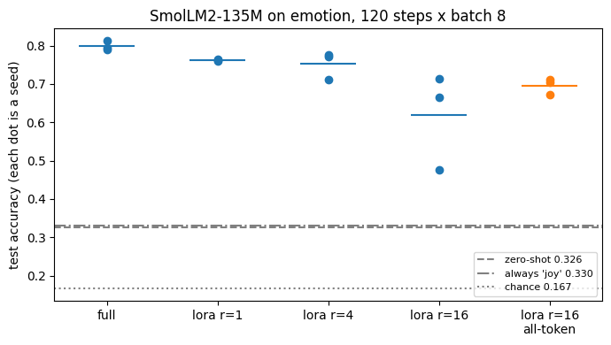
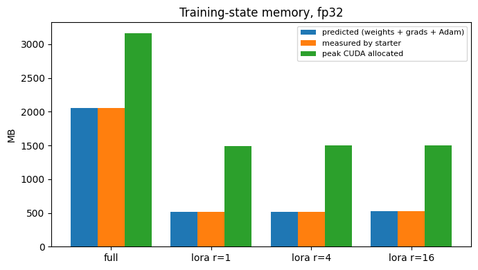

# Fine-Tune with LoRA

SmolLM2-135M from the Hugging Face Hub, measured zero-shot on the emotion task, then fine-tuned fully and with my own LoRA at ranks 1, 4 and 16.

The model stays a language model. Each prompt ends in `Emotion:` and the answer is one label token (sadness, joy, love, anger, fear, surprise). Chance is 1/6. Every training cell uses seeds 0, 1 and 2, the same 600 training examples, the same 500 test examples, 120 steps at batch 8 and AdamW.

## Run

Everything runs on Google Colab with a GPU runtime (Runtime > Change runtime type > T4 GPU).

1. Upload `Lab6.ipynb` to Colab (File > Upload notebook).
2. Run all. The first cells install `transformers peft datasets`, remove Colab's old `torchao` (the new peft refuses to load next to it), and check that `lab06_starter.py` sits next to the notebook. If it doesn't, an upload box opens for it. Then the starter runs once, unmodified.

`lab06_starter.py` is the course starter, unchanged. My code is in the notebook and imports from it. `Lab6.py` is the same code as a script. The whole run took about 12 minutes on a T4. Every number below comes from that run and is also saved in `lab6_results.json`.

## Prediction (written before running the sweep)

**Rank 16 against full fine-tuning:** I expect rank 16 to land within about 2 points of full fine-tuning, inside the spread of the seeds. The model already reads emotion in a tweet; the job is to route that to six label tokens at one position. That should be a small change, and a rank-16 update to every q_proj and v_proj is plenty for it. With only 120 steps, full fine-tuning also can't use most of its extra freedom.

**Rank 1:** I don't expect it to be clearly worse. Maybe 2 to 5 points under rank 16, with more spread between seeds. With alpha = 2r the update is scaled by 2 at every rank, so rank 1 isn't trained more weakly, it just has one direction per layer. That is still 60 layers' worth of directions, which I think is enough for a six-way choice. If rank 1 does fall well behind, it means the task needs more than one direction per layer to move.

## Results

Tesla T4, torch 2.14.1, transformers 5.22.2, peft 0.21.2.

### Zero-shot baseline

| | Accuracy |
|---|---|
| Chance (1/6) | 0.167 |
| Always "joy" (most common label) | 0.330 |
| Pretrained model, zero-shot | **0.326** |

Zero-shot is twice chance but no better than always answering joy. It says "love" for 265 of 500 tweets (only 39 are love), gives joy just 32 predictions and never says surprise.

### Answer-only loss

- Exactly one scored position per row, always the label word, and no prompt token scored (asserted).
- The off-by-one version fails the same assertion: it scores the `:` at the end of `Emotion:`.
- The loss Hugging Face computes from my labels equals my own cross-entropy at the last prompt position (6.229302 both), the position `S.evaluate` reads.
- The starter's all-token labels score 12 to 39 positions per row.

### LoRA layer checks

| Check | Result |
|---|---|
| Equals the wrapped q_proj at init | identical |
| Trainable parameters, r = 4 | 4,608 = 4 × (576 + 576) |
| Merged layer against two-path, B nonzero | max diff 1.6e-05 |
| Against a peft layer with the same A and B | max diff 0.0, peft scaling 2.0 |
| Scaled by alpha instead of alpha / r | off by 0.93 from peft |
| Whole model at init against pretrained | identical logits |
| Whole model against peft, B nonzero | max logit diff 0.0 |

| Rank | Wrapped layers | Trainable | Formula sum | % of model |
|---|---|---|---|---|
| 1 | 60 | 57,600 | 57,600 | 0.043 |
| 4 | 60 | 230,400 | 230,400 | 0.171 |
| 16 | 60 | 921,600 | 921,600 | 0.680 |

q_proj is 576 → 576 and v_proj is 576 → 192 (grouped-query attention), so each of the 30 layers adds r × 1,920.

### Learning rates (validation split, seed 0)

300 examples from the dataset's validation split, none of them in the test set. LoRA was tuned at rank 4 and that rate was used for every rank.

| Method | 1e-5 | 3e-5 | 1e-4 | 3e-4 | 1e-3 | 3e-3 | Chosen |
|---|---|---|---|---|---|---|---|
| Full | 0.717 | 0.750 | **0.803** | 0.740 | | | 1e-4 |
| LoRA r=4 | | | 0.547 | 0.640 | 0.700 | **0.767** | 3e-3 |

LoRA's best rate is at the top of its grid, so the true best could be higher.

### Rank sweep (answer-only loss, test set)

| Method | lr | Seed 0 | Seed 1 | Seed 2 | Mean | Std | Mean − zero-shot | Mean − chance | s/step |
|---|---|---|---|---|---|---|---|---|---|
| Full | 1e-4 | 0.812 | 0.794 | 0.790 | **0.799** | 0.012 | +0.473 | +0.632 | 0.171 |
| LoRA r=1 | 3e-3 | 0.762 | 0.760 | 0.764 | **0.762** | 0.002 | +0.436 | +0.595 | 0.131 |
| LoRA r=4 | 3e-3 | 0.776 | 0.712 | 0.772 | **0.753** | 0.036 | +0.427 | +0.587 | 0.132 |
| LoRA r=16 | 3e-3 | 0.476 | 0.664 | 0.714 | **0.618** | 0.125 | +0.292 | +0.451 | 0.131 |

| Method | Final loss seed 0 | Seed 1 | Seed 2 |
|---|---|---|---|
| Full | 0.313 | 0.483 | 0.383 |
| LoRA r=1 | 0.638 | 0.524 | 0.527 |
| LoRA r=4 | 0.481 | 0.546 | 0.509 |
| LoRA r=16 | 0.866 | 0.650 | 0.702 |

**Against my prediction:**
- **Rank 16 within about 2 points of full: wrong.** It's 18 points behind, seed 0 nearly collapsed, and it has the highest final loss of any run, so it failed to fit rather than overfit. My best explanation is the shared learning rate. alpha = 2r keeps the scale at 2, but Adam moves every entry of A and B by about the learning rate, so B A grows with r, and 3e-3 was already at the edge for rank 4. I didn't run the test that would separate rate from rank, so this stays a hypothesis.
- **Rank 1 not clearly worse: right.** It's 3.7 points behind full, training 0.04% of the parameters, and it's the most consistent method across seeds.

### All-token loss at rank 16

| Seed | Answer-only | All-token | Difference |
|---|---|---|---|
| 0 | 0.476 | 0.712 | +0.236 |
| 1 | 0.664 | 0.672 | +0.008 |
| 2 | 0.714 | 0.704 | −0.010 |
| Mean | 0.618 | 0.696 | +0.078 |

All-token scored higher on average, but almost all of that is seed 0. Averaged over 12 to 39 tokens, the answer gets a small share of each step, which acts like a lower learning rate. So the gain looks like it comes from stabilising the too-high rate, not from scoring the prompt itself. On seeds 1 and 2 it made no real difference.

### Memory: predicted against measured

Predicted from the model config with 4 bytes per weight and 16 per trainable parameter, before looking at the measurements.

| Method | Weights pred / meas (MB) | Grads pred / meas | Adam pred / meas | Total pred / meas | Pred − meas (bytes) | Peak CUDA (MB) | Peak / pred |
|---|---|---|---|---|---|---|---|
| Full | 513.13 / 513.13 | 513.13 / 513.13 | 1026.27 / 1026.27 | 2052.54 / 2052.54 | 0 | 3164.98 | 1.54 |
| LoRA r=1 | 513.35 / 513.35 | 0.22 / 0.22 | 0.44 / 0.44 | 514.01 / 514.01 | 0 | 1494.09 | 2.91 |
| LoRA r=4 | 514.01 / 514.01 | 0.88 / 0.88 | 1.76 / 1.76 | 516.65 / 516.65 | 0 | 1496.19 | 2.90 |
| LoRA r=16 | 516.65 / 516.65 | 3.52 / 3.52 | 7.03 / 7.03 | 527.20 / 527.20 | 0 | 1504.98 | 2.85 |

The prediction is exact. The peak is higher because the prediction leaves out everything that only exists during a step:

- **Logits:** 60 MB per copy at batch 8 × 40 tokens × 49,152 vocabulary, and the loss holds several copies.
- **Activations:** saved for the backward pass, roughly 420 MB by a back-of-envelope count.
- **Optimizer temporaries:** buffers inside AdamW and gradient clipping, which only matter for full fine-tuning.

The LoRA runs add ~980 MB over the prediction at every rank, because LoRA doesn't shrink activations: the backward pass still runs through all 30 layers to reach the adapters. Full fine-tuning adds ~1,110 MB; I put the extra ~130 MB down to the optimizer temporaries across 134M parameters.

## Conclusion

**What LoRA saved:** gradients and Adam state, exactly as predicted. They're 146× smaller at rank 16 and 2,335× smaller at rank 1. The whole training state went from 2,053 MB to 527 MB, and the peak from 3,165 MB to 1,505 MB, 2.1× smaller. It did not save the frozen weights or the activations, which is why the peak only halves, and steps were only 23% faster.

**What it cost:** at rank 1, 3.7 points (0.762 against 0.799), with both well above zero-shot (0.326) and the always-joy floor (0.330). At rank 4 the cost was 4.6 points. At rank 16 it was 18 points, but that comes from the learning rate I chose rather than LoRA's capacity, because rank 1 and 4 used the same rate and fit better.

**What my numbers establish:**
- My LoRA layer is correct: it matches peft exactly, starts identical to the pretrained model, and its parameter count follows r × (in + out).
- The memory accounting is exact.
- On this task and budget, a single direction per layer gets within 4 points of updating all 134M parameters.

**What they don't establish:**
- That rank 16 is worse than rank 1 in general. I never tuned a rate for rank 16, and the evidence points at the rate.
- That scoring the prompt helps. The all-token gain is one seed, and it's confounded with a smaller effective learning rate.
- That full fine-tuning beats LoRA in general. LoRA's best rate sat at the edge of its grid, so its own best wasn't found.

**Limits:**
- One small model (135M), one dataset, 600 training examples.
- A fixed budget of 120 steps at batch 8.
- Three seeds per cell, with the learning rate tuned on one seed and one rank.
- Timings and peak memory are from one Colab T4 and will differ on other hardware.
