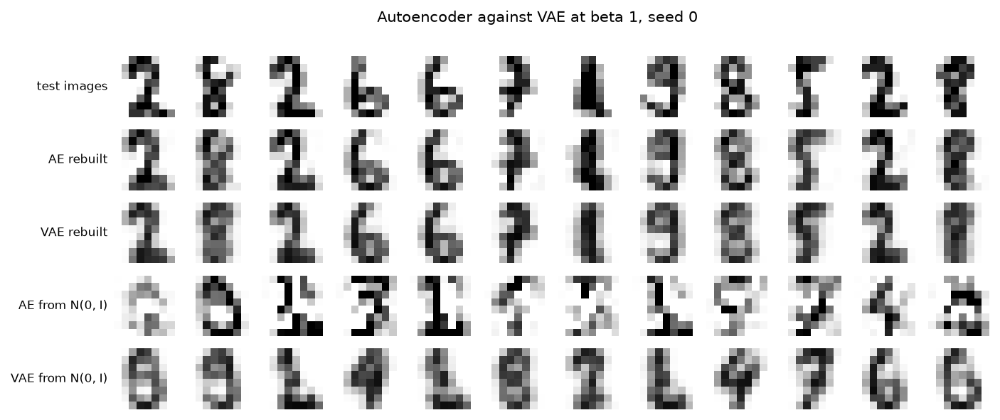
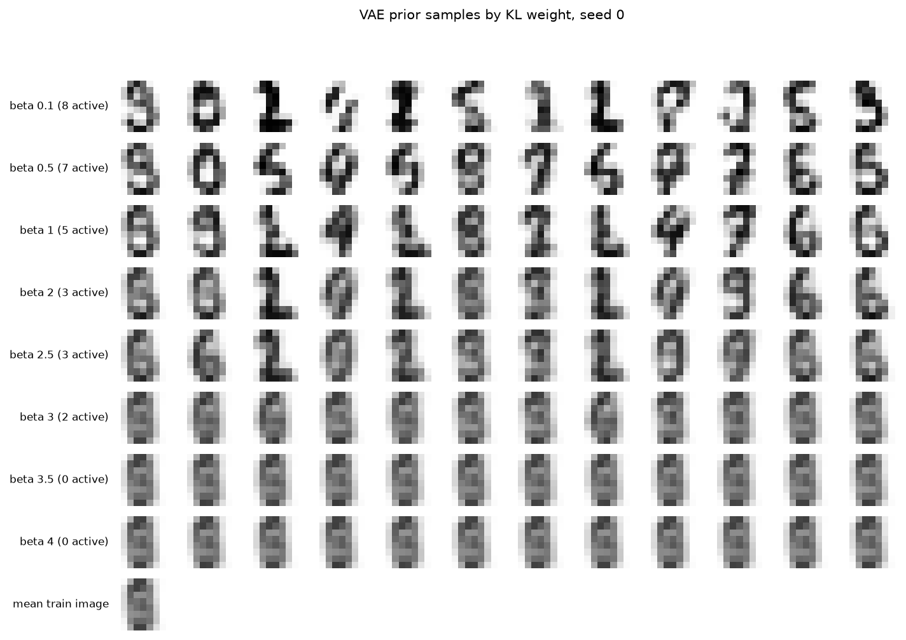
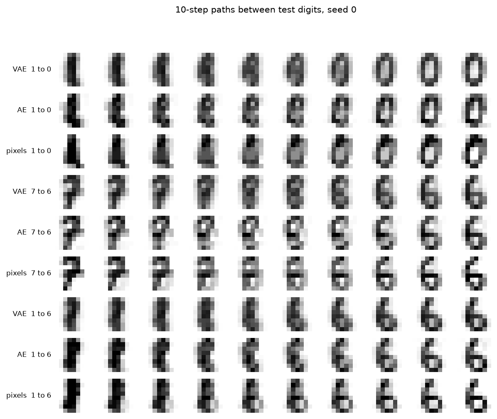
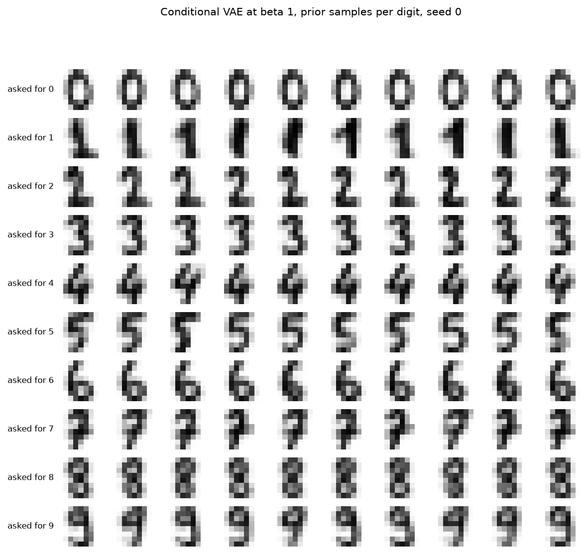
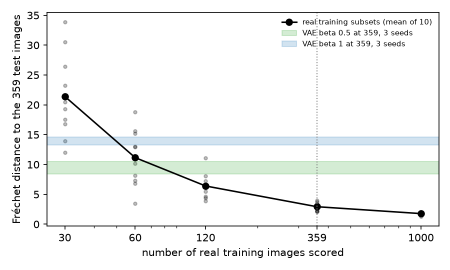

# Latent Spaces

A VAE written from scratch on 8 by 8 digits, compared with a plain autoencoder, varied in the weight on the KL term, probed, and measured.

The data, the autoencoder, the training loop and the sample measures all come from `lab07_starter.py`, unchanged. 1,438 training and 359 test images, pixels in [0, 1]. Every model has an 8-dimensional code and one hidden layer of 64 units on each side, and trains for 200 epochs with Adam at 2e-3 and batch 64 on seeds 0, 1 and 2. The seed sets both the initial weights and the shuffling.

## Setup

```bash
cd Lab-7
python3.12 -m venv .venv
source .venv/bin/activate   # Windows: .venv\Scripts\activate
pip install -r requirements.txt
```

`requirements.txt` is a `pip freeze` of that environment. It pins torch 2.2.2 and numpy 1.26.4 because torch 2.2.2 is the last build for Intel Macs and it needs numpy below 2.

## Run

```bash
python lab07_starter.py   # environment check, unmodified starter
python Lab7.py            # every table below, saves the five figures and lab7_results.json
```

`Lab7.ipynb` has the same code with its outputs and my notes. It covers the five pieces in order:

1. My `VAE`, `kl_to_standard_normal` and loss, then three checks: closed-form KL against Monte Carlo, the gradient reaching the encoder with and without the trick, and the loss at beta 1 against the negative ELBO from `torch.distributions`.
2. Autoencoder against VAE at beta 1: reconstruction, prior-sample scores, code spread, and how far prior draws land from the training codes.
3. The KL-weight sweep at 0.1, 0.5, 1, 2 and 4, plus 2.5, 3 and 3.5 to find the collapse.
4. Interpolation (VAE, AE and pixel cross-fade on 40 pairs) and a conditional VAE.
5. The six-set metric table and the Fréchet distance against sample size.

## Hardware

Intel Core i9-9980HK laptop CPU (8 threads), no GPU. The whole notebook takes about 5 minutes, the sweep is about 2 of that.

## Conventions

The reconstruction term is the Bernoulli negative log-likelihood summed over the 64 pixels, and the KL term is summed over the 8 code dimensions, so each is one number per image. The loss is the mean over the images in the batch of `reconstruction + beta * KL`. Every experiment uses this.

- Reconstruction error for the comparison with the autoencoder is pixel MSE on the test set, and for the VAE it decodes the posterior mean.
- The reconstruction and KL columns in the sweep are averaged over the 359 test images, one posterior draw per image.
- An active dimension is one whose posterior mean has a variance above 0.01 across the 1,438 training images.
- Every Fréchet distance, precision and recall uses the same feature network (the starter's `train_feature_net` on seed 0, 0.972 test accuracy), the 359 test images as the reference, and 359 generated images. The only exception is the sample-size study, which varies the size on purpose.
- VAE samples are decoded pixel probabilities (the sigmoid of the logits), not Bernoulli draws.

## Prediction (written before running the sweep)

What I already know from the beta 1 runs: on all three seeds the VAE uses 5 of its 8 dimensions (the other three have a posterior-mean std of 0.02 to 0.04), the KL on the test images is about 3.5 nats, and the prior samples have a Fréchet distance of 13 to 15. A fully collapsed model (the detached-sample run) has a loss of about 27, against about 24 for the working one, so the code only buys a few nats of reconstruction.

**Active dimensions:** 8 or 7 at beta 0.1, about 6 at 0.5, 5 at 1, 2 or 3 at 2, and 0 or 1 at 4. Each dimension has to save more than beta times its KL in reconstruction to stay on, and the first dimensions (which digit, how thick) save a lot more than the later ones, so they switch off one at a time as beta goes up.

**Collapse:** at beta 4, on at least one seed. Since the whole code only saves about 6 to 7 nats of reconstruction at beta 1, I don't think there's enough left to pay four times the KL. I expect a collapsed model to put out the same blurry average digit for every draw.

**Best samples:** beta 1, with 0.5 close. Below that the KL is too weak to make the codes fill N(0, I), so prior draws land in gaps like they did for the autoencoder and precision drops. Above 1 the samples get blurrier and lose the less common digits, so recall drops before precision does.

**How it turned out:** the active dimensions and the collapse were about right (8, 7, 5, 3 to 4 and 0, collapsed on all three seeds at 4). The best samples were wrong: beta 0.5 was best on every seed and beta 0.1 beat beta 1 too.

## Results

### Checks

Closed-form KL against 200,000 Monte Carlo draws, on random means and log-variances:

| Row | Closed form | Monte Carlo | Diff / SE | Averaged over dims (wrong) |
|---|---|---|---|---|
| 0 | 10.6361 | 10.6268 | 0.88 | 1.3295 |
| 1 | 21.9298 | 21.9343 | -0.09 | 2.7412 |
| 2 | 20.1421 | 20.1374 | 0.16 | 2.5178 |
| 3 | 9.3738 | 9.3593 | 1.21 | 1.1717 |
| 4 | 2.6726 | 2.6702 | 0.37 | 0.3341 |
| 5 | 16.7566 | 16.7472 | 0.48 | 2.0946 |

Gradient norm from one batch of 64, untrained VAE, seed 0:

| Sampling | Loss | Encoder mean layer | Encoder log-variance layer | Decoder output layer |
|---|---|---|---|---|
| Trick | Reconstruction only | 0.797573 | 0.301622 | 5.671147 |
| Detached | Reconstruction only | 0.000000 | 0.000000 | 5.671147 |
| `torch.no_grad` | Reconstruction only | 0.000000 | 0.000000 | 5.671147 |
| Detached | Reconstruction + KL | 0.266565 | 0.262317 | 5.671147 |

Trained for 200 epochs, the detached version's loss still falls (39.65 to 27.10) but its KL goes to 0.000 and its test MSE from the posterior mean is 0.0738, exactly the MSE of predicting the mean training image. The correct VAE reaches 0.0259.

Loss at beta 1 against `-(log p(x | z) - KL)` built with `torch.distributions` on the same draw: 25.414011 and 25.414011, difference 0. Over 2,000 draws, my loss averages 25.2211 ± 0.0046 and the sampled form `-(log p(x | z) + log p(z) - log q(z | x))` averages 25.2142 ± 0.0020.

### Autoencoder against VAE

| Model | Seed | Test MSE | Fréchet | Precision | Recall | Nearest train |
|---|---|---|---|---|---|---|
| AE | 0 | 0.0153 | 61.89 | 0.393 | 0.858 | 2.004 |
| AE | 1 | 0.0151 | 95.68 | 0.354 | 0.749 | 2.120 |
| AE | 2 | 0.0149 | 102.75 | 0.465 | 0.694 | 2.278 |
| VAE | 0 | 0.0259 | 14.61 | 0.889 | 0.496 | 1.148 |
| VAE | 1 | 0.0265 | 13.30 | 0.900 | 0.496 | 1.128 |
| VAE | 2 | 0.0264 | 13.96 | 0.897 | 0.437 | 1.128 |

Spread of the codes over the training images, per dimension (for the VAE, the std of the posterior mean, and the square root of that variance plus the mean posterior variance):

| Model | Seed | Measure | d0 | d1 | d2 | d3 | d4 | d5 | d6 | d7 |
|---|---|---|---|---|---|---|---|---|---|---|
| AE | 0 | std | 0.69 | 0.87 | 0.57 | 0.62 | 0.67 | 0.82 | 0.54 | 0.67 |
| AE | 0 | mean | 0.59 | 0.12 | 0.53 | -0.81 | 0.14 | 0.03 | 0.43 | -0.38 |
| AE | 1 | std | 0.63 | 0.57 | 0.75 | 0.65 | 1.09 | 0.66 | 0.74 | 0.65 |
| AE | 1 | mean | 0.10 | 0.85 | -0.08 | 0.13 | 0.59 | 0.82 | -0.75 | 0.27 |
| AE | 2 | std | 0.72 | 0.76 | 0.75 | 0.71 | 0.61 | 0.71 | 0.77 | 0.73 |
| AE | 2 | mean | 0.01 | -0.45 | 0.33 | 0.83 | 0.64 | -1.17 | 0.51 | 0.08 |
| VAE | 0 | std of mean | 0.94 | 0.96 | 0.94 | 0.48 | 0.02 | 0.82 | 0.02 | 0.03 |
| VAE | 0 | total | 1.02 | 1.04 | 1.03 | 1.00 | 0.99 | 1.00 | 1.00 | 1.00 |
| VAE | 1 | std of mean | 0.90 | 0.44 | 0.81 | 0.91 | 0.89 | 0.02 | 0.02 | 0.04 |
| VAE | 1 | total | 0.99 | 1.01 | 0.99 | 1.00 | 1.01 | 1.00 | 1.00 | 1.00 |
| VAE | 2 | std of mean | 0.89 | 0.91 | 0.90 | 0.03 | 0.53 | 0.82 | 0.03 | 0.02 |
| VAE | 2 | total | 1.00 | 1.00 | 1.00 | 1.00 | 0.99 | 1.00 | 1.00 | 1.00 |

Mean distance from 359 N(0, I) draws to the nearest training code, against the same for the 359 test codes:

| Model | Seed | N(0, I) to train | Test to train | Ratio | Largest correlation between dims |
|---|---|---|---|---|---|
| AE | 0 | 1.945 | 0.514 | 3.78 | 0.48 |
| AE | 1 | 2.060 | 0.530 | 3.88 | 0.50 |
| AE | 2 | 2.104 | 0.537 | 3.92 | 0.45 |
| VAE | 0 | 1.346 | 1.340 | 1.00 | 0.07 |
| VAE | 1 | 1.310 | 1.301 | 1.01 | 0.07 |
| VAE | 2 | 1.310 | 1.308 | 1.00 | 0.05 |



The AE reconstructs better on every seed, which is the honest cost of the KL term. Its codes are not far from unit spread, but they sit off-centre, correlated and thin, so a draw from N(0, I) lands about 3.9 times further from any training code than a test image's code does, in a region the decoder never trained on. The VAE's total spread is 0.99 to 1.04 in every dimension and prior draws land exactly as close to its training codes as test codes do (ratio 1.00), which is why its prior samples score 13 to 15 against 62 to 103. Three of its eight dimensions are unused on every seed.

### KL weight

| Beta | Seed | Recon | KL | Active | Fréchet | Precision | Recall |
|---|---|---|---|---|---|---|---|
| 0.1 | 0 | 17.28 | 14.20 | 8 | 11.17 | 0.660 | 0.852 |
| 0.1 | 1 | 17.06 | 14.20 | 8 | 12.77 | 0.719 | 0.869 |
| 0.1 | 2 | 17.15 | 14.27 | 8 | 13.32 | 0.769 | 0.808 |
| 0.5 | 0 | 19.25 | 5.83 | 7 | 9.58 | 0.822 | 0.741 |
| 0.5 | 1 | 19.26 | 5.96 | 7 | 8.40 | 0.841 | 0.747 |
| 0.5 | 2 | 19.11 | 6.15 | 7 | 10.50 | 0.825 | 0.769 |
| 1 | 0 | 20.88 | 3.48 | 5 | 14.61 | 0.889 | 0.496 |
| 1 | 1 | 21.20 | 3.22 | 5 | 13.30 | 0.900 | 0.496 |
| 1 | 2 | 21.13 | 3.28 | 5 | 13.96 | 0.897 | 0.437 |
| 2 | 0 | 24.19 | 1.26 | 3 | 43.91 | 0.936 | 0.064 |
| 2 | 1 | 24.16 | 1.16 | 3 | 46.62 | 0.905 | 0.092 |
| 2 | 2 | 24.22 | 1.26 | 4 | 43.35 | 0.928 | 0.100 |
| 2.5 | 0 | 25.44 | 0.66 | 3 | 68.06 | 0.919 | 0.053 |
| 2.5 | 1 | 25.42 | 0.60 | 3 | 75.53 | 0.933 | 0.014 |
| 2.5 | 2 | 25.66 | 0.62 | 3 | 75.36 | 0.939 | 0.014 |
| 3 | 0 | 27.09 | 0.07 | 2 | 157.78 | 0.989 | 0.000 |
| 3 | 1 | 26.93 | 0.07 | 1 | 164.50 | 0.992 | 0.000 |
| 3 | 2 | 27.08 | 0.08 | 2 | 163.56 | 0.981 | 0.000 |
| 3.5 | 0 | 27.26 | 0.00 | 0 | 211.41 | 1.000 | 0.000 |
| 3.5 | 1 | 27.24 | 0.00 | 0 | 216.69 | 1.000 | 0.000 |
| 3.5 | 2 | 27.26 | 0.00 | 0 | 220.17 | 1.000 | 0.000 |
| 4 | 0 | 27.26 | 0.00 | 0 | 218.99 | 1.000 | 0.000 |
| 4 | 1 | 27.25 | 0.00 | 0 | 219.64 | 1.000 | 0.000 |
| 4 | 2 | 27.26 | 0.00 | 0 | 224.31 | 1.000 | 0.000 |

2.5, 3 and 3.5 are extra runs I added to find the collapse, under the same settings.



Raising beta costs reconstruction and lowers the KL at every step, and dimensions switch off one or two at a time. Every seed collapses between beta 3 and 3.5: at 3 the KL is down to 0.07 nats, at 3.5 it is 0.00. The collapsed models put out the mean training image for every draw (largest pixel std across 359 samples 0.012 to 0.016, within 0.011 of the mean image), their encoders return N(0, 1) whatever goes in, and their reconstruction term, 27.26, matches the detached-sample model from the checks. Beta 0.5 gave the lowest Fréchet distance on every seed. The collapsed models get a perfect precision of 1.000.

### Interpolation

40 pairs of test images with different labels, 10 steps each, read by the feature network:

| Path | Seed | Confidence | Class changes | Share with 1 change | Third-class steps | Both ends right | Middle-4 confidence |
|---|---|---|---|---|---|---|---|
| VAE | 0 | 0.931 | 1.50 | 0.40 | 1.67 | 0.90 | 0.891 |
| VAE | 1 | 0.935 | 1.58 | 0.40 | 1.95 | 0.88 | 0.908 |
| VAE | 2 | 0.925 | 1.55 | 0.43 | 1.75 | 0.90 | 0.888 |
| AE | 0 | 0.929 | 1.58 | 0.43 | 1.58 | 0.93 | 0.876 |
| AE | 1 | 0.936 | 1.65 | 0.47 | 1.95 | 0.95 | 0.898 |
| AE | 2 | 0.937 | 1.58 | 0.47 | 1.65 | 0.98 | 0.899 |
| Pixels | any | 0.925 | 1.42 | 0.62 | 0.80 | 0.95 | 0.860 |



The latent path does not beat the pixel cross-fade on these measures. Overall confidence is the same within 0.01, and the pixel path changes class the fewest times and passes through a third digit less than half as often. The VAE's path is more confident in the middle four steps on every seed (0.888 to 0.908 against 0.860), and its in-between images look like digits morphing rather than two digits stacked, but on the way it goes through shapes the feature network reads as other digits. 10 to 12% of VAE paths also start or end on a misread reconstruction.

### Conditioning

Share of 200 prior samples per digit classified as the digit requested:

| Seed | 0 | 1 | 2 | 3 | 4 | 5 | 6 | 7 | 8 | 9 | All | Test KL | Active |
|---|---|---|---|---|---|---|---|---|---|---|---|---|---|
| 0 | 1.000 | 1.000 | 1.000 | 1.000 | 1.000 | 1.000 | 1.000 | 1.000 | 0.995 | 1.000 | 0.999 | 1.26 | 2 |
| 1 | 1.000 | 1.000 | 1.000 | 1.000 | 1.000 | 1.000 | 1.000 | 1.000 | 1.000 | 1.000 | 1.000 | 1.31 | 2 |
| 2 | 1.000 | 1.000 | 1.000 | 1.000 | 1.000 | 1.000 | 1.000 | 1.000 | 1.000 | 1.000 | 1.000 | 1.23 | 2 |

Class counts of 1,000 samples from the unconditional beta 1 VAE:

| Seed | 0 | 1 | 2 | 3 | 4 | 5 | 6 | 7 | 8 | 9 |
|---|---|---|---|---|---|---|---|---|---|---|
| 0 | 103 | 88 | 89 | 133 | 110 | 82 | 119 | 78 | 120 | 78 |
| 1 | 97 | 79 | 87 | 120 | 98 | 104 | 117 | 93 | 120 | 85 |
| 2 | 97 | 79 | 85 | 123 | 103 | 96 | 90 | 87 | 129 | 111 |
| Train set | 151 | 147 | 141 | 154 | 151 | 142 | 137 | 140 | 136 | 139 |

Mean pixel distance between pairs of images of the same digit: 2.248 for real training images, 1.110 to 1.136 for the conditional VAE and 1.360 to 1.397 for the unconditional one.



The label lets me ask for a digit and get it, while the unconditional VAE's mix leans towards 3s and 8s (1.5 to 1.7 times as many of the commonest as the rarest) on a near-balanced training set. With the label given for free, the conditional VAE keeps only 2 active dimensions and its samples vary about half as much within a digit as the real ones.

### What the metrics capture

Six sets of 359 images, same feature network:

| Set | Seed | Fréchet | Precision | Recall | Nearest train |
|---|---|---|---|---|---|
| Real train | 0 | 1.91 | 0.925 | 0.916 | 0.000 |
| Real train | 1 | 1.72 | 0.914 | 0.919 | 0.000 |
| Real train | 2 | 2.01 | 0.914 | 0.916 | 0.000 |
| Copier | 0 | 1.86 | 0.928 | 0.911 | 0.134 |
| Copier | 1 | 1.74 | 0.914 | 0.925 | 0.136 |
| Copier | 2 | 1.83 | 0.914 | 0.925 | 0.135 |
| Mean + noise | 0 | 139.39 | 0.944 | 0.000 | 1.617 |
| Mean + noise | 1 | 136.79 | 0.953 | 0.000 | 1.620 |
| Mean + noise | 2 | 139.91 | 0.958 | 0.000 | 1.619 |
| Collapsed VAE (beta 4) | 0 | 218.99 | 1.000 | 0.000 | 1.510 |
| Collapsed VAE (beta 4) | 1 | 219.64 | 1.000 | 0.000 | 1.506 |
| Collapsed VAE (beta 4) | 2 | 224.31 | 1.000 | 0.000 | 1.514 |
| VAE beta 1 | 0 | 14.61 | 0.889 | 0.496 | 1.148 |
| VAE beta 1 | 1 | 13.30 | 0.900 | 0.496 | 1.128 |
| VAE beta 1 | 2 | 13.96 | 0.897 | 0.437 | 1.128 |
| Autoencoder | 0 | 61.89 | 0.393 | 0.858 | 2.004 |
| Autoencoder | 1 | 95.68 | 0.354 | 0.749 | 2.120 |
| Autoencoder | 2 | 102.75 | 0.465 | 0.694 | 2.278 |

For reference, real test images are 1.068 from their nearest training image.

Fréchet distance between random subsets of real training images and the 359 test images, ten subsets per size:

| Size | Mean | Std | Min | Max |
|---|---|---|---|---|
| 30 | 21.41 | 6.72 | 12.01 | 33.87 |
| 60 | 11.15 | 4.52 | 3.48 | 18.79 |
| 120 | 6.40 | 2.00 | 3.85 | 11.09 |
| 359 | 2.93 | 0.63 | 2.14 | 3.94 |
| 1,000 | 1.77 | 0.20 | 1.30 | 2.02 |



Each measure catches one kind of failure and misses another. The Fréchet distance catches a model that is blurry, collapsed or off the digits, but scores the copier the same as real data and depends on the sample size: real images score 21.4 on 30 samples and 1.8 on 1,000, so real data on 30 images can look worse than my VAE on 359. Precision catches samples that land away from the real digits (the autoencoder gets 0.35 to 0.47), but gives 1.000 to a collapsed model that outputs one average digit, because that one image sits inside the real data's neighbourhoods. Recall catches the missing variety in that model (0.000) but rewards the autoencoder's scattered noise with 0.69 to 0.86, more than the VAE. The nearest-training distance is the only one that catches the copier (0.13 against 1.07 for unseen test images), but noise is far from everything, so it can't judge quality. Accuracy can't be used because a generated image has no true label, and even classifying the samples would rate a model that only draws one perfect 3 as highly as one that draws every digit. What matters is how the whole set of samples compares with the whole set of real images.

## Conclusion

- **What the VAE gave that the autoencoder did not:** a decoder trained on the region N(0, I) actually covers, so it can generate. Prior draws land as close to its training codes as test codes do, against 3.9 times further for the autoencoder, and its Fréchet distance is 13 to 15 against 62 to 103. It costs reconstruction (0.026 against 0.015 MSE).
- **The KL weight:** trades reconstruction for KL on every seed and switches dimensions off one at a time, until every seed collapses to the mean digit between beta 3 and 3.5. Beta 0.5 sampled best, which is not what I predicted.
- **Latent space:** straight latent paths were not better than a pixel cross-fade by these measures. Conditioning on the label gave the requested digit almost every time, with less variety.
- **The metrics:** each of the four misses something the others catch, so I need all of them, at a fixed sample size and with one feature network, to say anything.
- **What this doesn't establish:** anything about larger images or architectures, or about the measures with a feature network other than the small one I trained. The latent-path result especially depends on that network, which was never trained to be unsure about blended images.

## Known limitations

- 8 by 8 digits, one small architecture (one 64-unit hidden layer each side), a fixed budget of 200 epochs at one learning rate, and three seeds per cell.
- One feature network that I trained myself (0.972 test accuracy) stands in for Inception. Its 32 features are more than the 30 images in the smallest subset, so the covariance at that size leans on the starter's small diagonal term.
- No KL annealing, free bits or larger code size was tried, so I can't say whether any of them would keep beta 1's three unused dimensions on or move the collapse.
- The interpolation measures only straight lines between posterior means, and only 40 pairs.
- The within-digit variety measure compares decoded probabilities with real pixels, which favours the real images a little.
