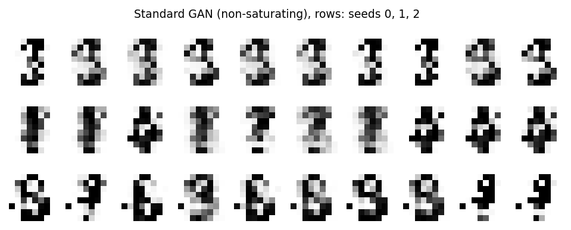
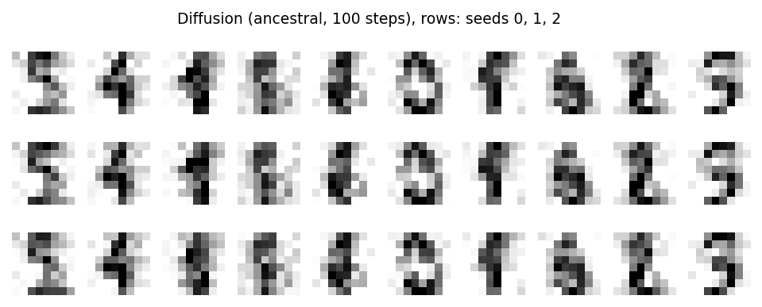
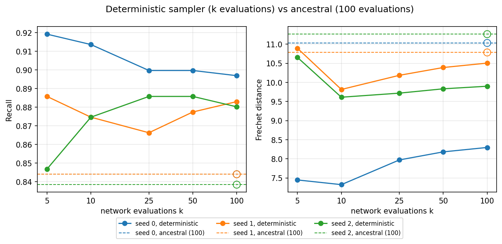
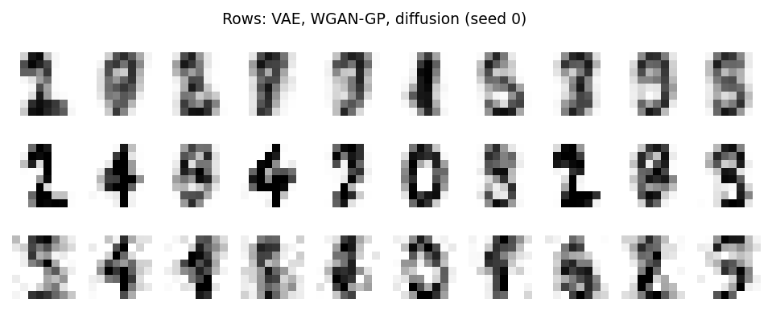

# Two Ways to Generate

A GAN and a diffusion model written from scratch on 8 by 8 digits, checked against quantities I can work out exactly, then compared with each other and with a VAE.

The data is 1,438 training and 359 test images with pixels in [0, 1]. Every model is trained on seeds 0, 1 and 2. Every Fréchet distance, precision and recall uses the same feature network and 359 generated images, and every sample is drawn from the same starting noise (sample seed 9), so two runs I compare differ only in the thing being tested.

## Run

```bash
pip install -r requirements.txt
python Lab8.py
```

`lab08_starter.py` is the course starter, unchanged. It supplies the data, the networks, the noise schedule, the VAE and the scoring, and my code imports from it. `Lab8.ipynb` has the code with its outputs and my notes, and `Lab8.py` is the same code as a script. `python Lab8.py --pieces 2` runs one part on its own. Every number below comes from that run and is also saved in `lab8_results.json`.

## Prediction (written before training the GANs)

**Which GAN keeps more of the digits:** WGAN-GP. I expect recall of about 0.3 to 0.6 for WGAN-GP and 0.1 to 0.35 for the standard GAN, with the standard GAN at least as precise, because a generator that has dropped digits can still be sharp on the ones it kept. For the standard GAN I expect 6 to 9 digits to show up, unevenly, with one or two easy digits taking most of the samples. For WGAN-GP I expect all 10, at roughly 20 to 60 each.

**Why:** the standard discriminator only says real or fake. The generator can satisfy it by settling on a few digits it hasn't learned to reject yet, and the discriminator then chases them one at a time, so digits get dropped. The WGAN-GP critic gives a score whose gradient doesn't vanish when the two sets are far apart, and the penalty keeps it smooth, so every generated point gets pushed toward the real data.

**The critic:** I expect its gradient norm to start above 1 (an untrained critic) and settle near 1, and the score gap between real and fake to shrink from several units to about 1 to 3 as the generator improves.

**Fewer sampling steps:** I expect the deterministic sampler to lose recall as the number of steps drops, and at 100 steps to be about as good as the ancestral sampler, so any gap would come from the step count rather than the kind of sampler.

## Results

### Checks

| Check | Result |
|---|---|
| GAN losses against their definitions (float64) | largest difference 2.8e-14 |
| Naive log(1 − sigmoid) at logit 40 (float32) | −inf; mine gives −40 |
| Trained 1-D discriminator against the optimal one | largest gap 0.017, 0.032, 0.028 (bound 0.05) |
| Original generator loss once the discriminator wins | gradient about 1e-8, against 5.7 for non-saturating |
| Gradient penalty, linear critic with norm 1 and 3 | exactly 0 and 4 (a whole-batch norm would give 106 and 1,085) |
| Forward process after 10, 50 and 99 steps | within 0.0073 of exact (bound 0.015); a wrong closed form fails |

The original generator loss really does stop teaching once the discriminator wins: the gradient it sends back is about a billion times smaller than the non-saturating loss's. That's why both GANs below use the non-saturating version.

### Standard GAN against WGAN-GP

Same networks, 4,000 generator steps, batch 128. The standard GAN takes one discriminator step per generator step; WGAN-GP takes three critic steps with the penalty at weight 10.

| Kind | Seed | Fréchet | Precision | Recall | Digits present |
|---|---|---|---|---|---|
| Standard GAN | 0 | 481.89 | 0.799 | 0.000 | 1 |
| Standard GAN | 1 | 175.24 | 0.705 | 0.000 | 6 |
| Standard GAN | 2 | 128.27 | 0.273 | 0.006 | 8 |
| WGAN-GP | 0 | 3.97 | 0.788 | 0.900 | 10 |
| WGAN-GP | 1 | 5.41 | 0.791 | 0.875 | 10 |
| WGAN-GP | 2 | 4.61 | 0.752 | 0.942 | 10 |

| Run | 0 | 1 | 2 | 3 | 4 | 5 | 6 | 7 | 8 | 9 |
|---|---|---|---|---|---|---|---|---|---|---|
| Standard, seed 0 | 0 | 0 | 0 | 359 | 0 | 0 | 0 | 0 | 0 | 0 |
| Standard, seed 1 | 0 | 48 | 0 | 96 | 118 | 0 | 0 | 40 | 5 | 52 |
| Standard, seed 2 | 0 | 35 | 0 | 3 | 66 | 6 | 91 | 37 | 17 | 104 |
| WGAN-GP, seed 0 | 48 | 41 | 38 | 28 | 32 | 28 | 43 | 42 | 26 | 33 |
| Test set | 27 | 35 | 36 | 29 | 30 | 40 | 44 | 39 | 38 | 41 |




Precision doesn't catch the collapse. Seed 0 of the standard GAN scores 0.80 while every sample is the same 3, because precision only asks whether a sample looks like some real digit.

**Against my prediction:**
- **WGAN-GP keeps more digits: right,** and by much more than I guessed. Recall was 0.88 to 0.94, against my 0.3 to 0.6, with all 10 digits on every seed at 24 to 54 each.
- **The standard GAN drops some digits: right, but far worse than I expected.** It covered 1, 6 and 8 digits with recall 0.000 to 0.006, and seed 0 made nothing but 3s.
- **The standard GAN is at least as precise: wrong** on two of three seeds.
- **The critic's gradient norm starts above 1: wrong.** It sat at about 1.0 from the start and stayed there. The score gap shrank, but from about 1.2 to 0.3, not from several units.

### Diffusion

**Ring:** all 8 modes covered on every seed, with 94 to 96% of samples near a mode (real data: 100%). A cosine learning-rate decay also covered all 8, but with fewer samples near a mode (85 to 91%).


**Digits** (100-step ancestral sampler, samples rescaled to [0, 1] before scoring):

| Seed | Fréchet | Precision | Recall | Digits present | Closest sample to a training image |
|---|---|---|---|---|---|
| 0 | 11.03 | 0.760 | 0.844 | 10 | 0.838 |
| 1 | 10.78 | 0.774 | 0.844 | 10 | 0.979 |
| 2 | 11.26 | 0.766 | 0.838 | 10 | 0.963 |



Scoring seed 0 without rescaling it back to [0, 1] gives Fréchet 95.44 and recall 0.507 instead of 11.03 and 0.844, so one missing line would make a working model look broken. No sample is a copy: real test images get as close as 0.54 to a training image, and no diffusion sample gets closer than 0.84. The samples are readable but grainy.

### Fewer sampling steps

The deterministic sampler can skip steps, but comparing it with the 100-step ancestral sampler changes two things at once: the kind of sampler and the number of steps. To pull them apart I also ran the deterministic sampler at 100 steps. Against the ancestral sampler it keeps the same 100 steps and the same starting noise, so their difference is the sampler alone.

| Seed | Ancestral (100) | Det. 5 | Det. 10 | Det. 25 | Det. 50 | Det. 100 |
|---|---|---|---|---|---|---|
| 0 | 0.844 | 0.919 | 0.914 | 0.900 | 0.900 | 0.897 |
| 1 | 0.844 | 0.886 | 0.875 | 0.866 | 0.877 | 0.883 |
| 2 | 0.838 | 0.847 | 0.875 | 0.886 | 0.886 | 0.880 |

Recall by sampler. Averaged over seeds, the gap splits like this:

| Steps | Sampler part (det. 100 − ancestral) | Step part (det. k − det. 100) |
|---|---|---|
| 5 | +0.045 | −0.003 |
| 10 | +0.045 | +0.001 |
| 25 | +0.045 | −0.003 |
| 50 | +0.045 | +0.001 |



**Against my prediction: wrong on both counts.** Recall didn't drop with fewer steps, and at 100 steps the deterministic sampler beat the ancestral one on every seed, so the gap is the kind of sampler, not the step count. Redrawing with two more sample seeds moves recall by 0.02 to 0.09, so I'm sure of the direction of the sampler effect but not its size, and there's no step effect I can establish. Five steps take about 0.005 s for 359 samples, against about 0.09 s for 100.

### Three families

| Family | Fréchet | Precision | Recall | Closest sample to a training image | Network passes per sample |
|---|---|---|---|---|---|
| VAE | 15.58 | 0.906 | 0.448 | 0.553 | 1 |
| WGAN-GP | 4.66 | 0.777 | 0.905 | 0.669 | 1 |
| Diffusion (100-step ancestral) | 11.02 | 0.767 | 0.842 | 0.927 | 100 |
| Real training images, scored as generated | 2.83 | 0.900 | 0.911 | 0 | – |

Means over the three seeds. Real test images get as close as 0.538 to a training image, so none of the three is copying.



## Conclusion

**VAE:** the cheapest sampler and the most precise (0.906), with one network pass per sample. What it costs is coverage: recall is only 0.448, and its samples are blurred.

**WGAN-GP:** the best Fréchet (4.66) and recall (0.905), with all 10 digits on every seed. Its recall is level with real training images (0.911). It took the longest to train, and the stability comes from the loss and the penalty, not from GANs in general: the standard GAN with the same networks and budget collapsed on every seed.

**Diffusion:** all 10 digits, recall 0.842 and the steadiest of the three across seeds, but grainy samples and 100 network passes per sample. That cost is a setting, though: the deterministic sampler at 5 steps did as well as the 100-step ancestral one.

**What my numbers establish:**
- My losses, penalty and forward process are correct: each matches its exact value.
- On these digits, WGAN-GP beat the other two on Fréchet and recall, and the standard GAN collapsed.
- Fewer deterministic steps didn't cost recall here.

**What they don't establish:**
- Which change makes WGAN-GP stable. I changed the loss, the critic steps and the learning rate together.
- An order on digit balance. The differences are smaller than the spread between seeds.
- Why the standard GAN collapsed on every seed rather than just dropping a few digits.

**Limits:**
- 8 by 8 digits and small networks, so none of this says what happens on real photos.
- One feature network I trained myself is the ruler for every score; a different one could reorder close results.
- One fixed budget and one learning rate per model, with no tuning, so the standard GAN's collapse may be partly a tuning result.
- Three seeds per model.
