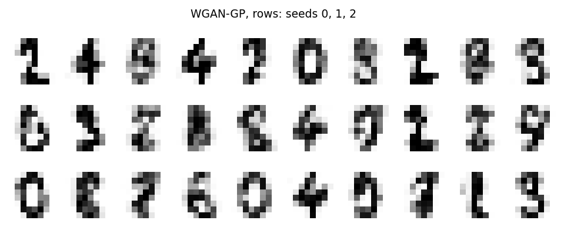
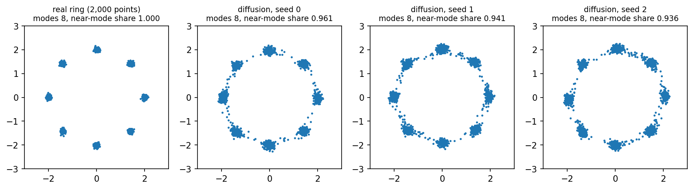

# Two Ways to Generate

A GAN and a diffusion model written from scratch on the starter's 8 by 8 digits, each checked against something I can work out exactly, then compared with each other and with a VAE.

`lab08_starter.py` is the course starter, unchanged. It supplies the data (1,438 training and 359 test images), the networks, the noise schedule, the VAE and the sample scoring. Every trained model uses seeds 0, 1 and 2. Every Fréchet distance, precision and recall uses the same feature network and 359 generated images, and every evaluation draw starts from sample seed 9, so runs I compare start from the same noise.

## Run

```bash
pip install -r requirements.txt
python lab08_starter.py          # check the unmodified starter runs
python Lab8.py                   # all five pieces, the figures and lab8_results.json
python Lab8.py --pieces 2        # or one piece at a time (1 to 5)
```

`Lab8.ipynb` is the same code with its outputs and my notes, in five pieces:

1. The GAN losses, checked against their definitions, the optimal discriminator and the saturation of the original loss.
2. The gradient penalty, then a standard GAN against WGAN-GP.
3. Diffusion: the forward process, the loss and the sampler, checked, then trained on a ring and on the digits.
4. Steps against sampler: how few denoising steps I can use.
5. WGAN-GP, diffusion and the VAE scored the same way.

## Prediction (written before running piece 2)

I wrote this before running anything in this lab except the unmodified starter. What I am going on is the handout, the theory of the two losses, and what I saw in Lab 7: the starter's 30-epoch VAE scores a Fréchet distance of 31.1, precision 0.847 and recall 0.201 on this feature network, so recall for a weak generator on these digits can be low even when the samples look fine. The test set has 359 images with digit counts 27, 35, 36, 29, 30, 40, 44, 39, 38, 41 for digits 0 to 9.

**Higher recall:** WGAN-GP. I expect a recall of about 0.3 to 0.6 for WGAN-GP and about 0.1 to 0.35 for the standard GAN, with the standard GAN's precision at least as high as WGAN-GP's, since a generator that has dropped modes can still be sharp on the ones it kept.

**Digit counts:** for the standard GAN I expect 6 to 9 of the 10 digits to appear, with a very uneven spread, some digit with 80 or more of the 359 samples and one or two with under 10. A few digits that are easy for a small network (1, 0, 7) could dominate. For WGAN-GP I expect all 10 digits to appear, with counts nearer the test mix (roughly 20 to 60 each), though not equal to it.

**Why:** when the discriminator is winning, the non-saturating loss still gives the generator a useful gradient, but the discriminator only says real or fake. A generator can satisfy it by settling on a few digits the discriminator has not yet learned to reject, and the discriminator then chases them one at a time, so modes get dropped. The critic in WGAN-GP gives an unbounded score whose gradient does not vanish when the two sets are apart, and the gradient penalty keeps that score smooth, so every generated point is pushed toward the real data wherever it is. Three critic steps per generator step keep the critic close to its optimum. That should cover more of the data, at the cost of less sharp samples (a lower precision) early on.

**Stability and gradient behaviour:** I expect the critic's gradient norm on the interpolated points to start well away from 1 (somewhere above 1, maybe 1 to 3, because the critic is untrained) and settle close to 1 by the end of the run (0.8 to 1.2), since that is what the penalty pulls it toward. I expect the score gap (real minus generated) to be large early, several units, while the generator is poor, and to shrink to about 1 to 3 by the last 500 steps as the generator improves. I expect all three standard GAN runs to train without a crash, but one of the three seeds to look clearly worse than the others. I do not expect a WGAN-GP collapse.

**Piece 4:** I expect the deterministic sampler to lose recall as k drops, with 5 steps clearly worse than 100, and with the deterministic sampler at 100 steps about as good as the ancestral one, so most of any gap would come from the number of steps rather than the kind of sampler.

**Against my prediction:**
- **WGAN-GP has the higher recall: right.** It was higher on every seed, but by far more than I guessed: 0.88 to 0.94 against my 0.3 to 0.6.
- **The standard GAN drops some digits: right, but much worse than I expected.** I said 6 to 9 digits; it covered 1, 6 and 8, with recall 0.000 to 0.006. Seed 0 made nothing but 3s.
- **The standard GAN is at least as precise: mostly wrong.** That only held on seed 0.
- **WGAN-GP covers all 10 digits at roughly 20 to 60 each: right.** All 10 on every seed, with 24 to 54 each.
- **Critic gradient norm starts above 1 and settles near 1: half right.** It was about 1.0 from the start, not above it, and about 1.01 at the end.
- **Steps against sampler: wrong on both parts.** Recall didn't drop as the steps went down, and at 100 steps the deterministic sampler beat the ancestral one, so the gap came from the kind of sampler, not the number of steps.

## Results

Every number below is in `lab8_results.json`.

### Checks

| Check | Result |
|---|---|
| GAN losses against their definitions (float64) | largest difference 2.8e-14 |
| Naive log(1 - sigmoid) at logit 40 (float32) | -inf; mine gives -40 |
| Trained 1-D discriminator against the optimal one | largest gap 0.017, 0.032, 0.028 (bound 0.05) |
| Original generator loss once the discriminator wins | gradient about 1e-8 against 5.7 for non-saturating |
| Gradient penalty, linear critic with norm 1 and 3 | exactly 0 and 4 (whole-batch norm would give 106 and 1,085) |
| Forward process, both readings of "after 10, 50, 99 steps" | within 0.0073 of exact (bound 0.015); the wrong closed form fails |

### Standard GAN against WGAN-GP

Same networks, 4,000 generator steps, batch 128. The standard GAN takes one discriminator step per generator step; WGAN-GP takes three critic steps with the penalty at weight 10.

| Kind | Seed | Fréchet | Precision | Recall | Digits present |
|---|---|---|---|---|---|
| Standard GAN | 0 | 481.89 | 0.799 | 0.000 | 1 |
| Standard GAN | 1 | 175.24 | 0.705 | 0.000 | 6 |
| Standard GAN | 2 | 128.27 | 0.273 | 0.006 | 8 |
| WGAN-GP | 0 | 3.97 | 0.788 | 0.900 | 10 |
| WGAN-GP | 1 | 5.41 | 0.791 | 0.875 | 10 |
| WGAN-GP | 2 | 4.61 | 0.752 | 0.942 | 10 |

| Run | 0 | 1 | 2 | 3 | 4 | 5 | 6 | 7 | 8 | 9 |
|---|---|---|---|---|---|---|---|---|---|---|
| Standard, seed 0 | 0 | 0 | 0 | 359 | 0 | 0 | 0 | 0 | 0 | 0 |
| Standard, seed 1 | 0 | 48 | 0 | 96 | 118 | 0 | 0 | 40 | 5 | 52 |
| Standard, seed 2 | 0 | 35 | 0 | 3 | 66 | 6 | 91 | 37 | 17 | 104 |
| WGAN-GP, seed 0 | 48 | 41 | 38 | 28 | 32 | 28 | 43 | 42 | 26 | 33 |
| Test set | 27 | 35 | 36 | 29 | 30 | 40 | 44 | 39 | 38 | 41 |




The standard GAN collapsed on every seed; WGAN-GP covered every digit with a mix close to the test set. Precision doesn't catch the collapse: seed 0 scores 0.80 while every sample is the same 3, because precision only asks whether a sample looks like some real digit. During WGAN-GP training the critic's gradient norm on the mixed points stayed at about 1.0, as the penalty asks, and the real-minus-fake score gap shrank from about 1.2 to about 0.3.

### Diffusion

**Ring:** all 8 modes covered on every seed, with 94 to 96% of samples near a mode (real data: 100%). A cosine-decay extra also covered all 8 but with fewer samples near a mode (85 to 91%).



**Digits** (100-step ancestral sampler, samples rescaled to [0, 1] before scoring):

| Seed | Fréchet | Precision | Recall | Digits present | Closest sample to a training image |
|---|---|---|---|---|---|
| 0 | 11.03 | 0.760 | 0.844 | 10 | 0.838 |
| 1 | 10.78 | 0.774 | 0.844 | 10 | 0.979 |
| 2 | 11.26 | 0.766 | 0.838 | 10 | 0.963 |


Scoring seed 0 without the rescale gives Fréchet 95.44 and recall 0.507 instead of 11.03 and 0.844, so that one missing line would make a working model look broken. No sample is a copy: the closest any gets to a training image is further than real test images get (0.54). The samples are readable but grainy.

### Steps against sampler

To separate the kind of sampler from the number of steps, I added a deterministic run at 100 steps. Against the ancestral sampler it uses the same 100 steps and the same starting noise, so the difference between them is the sampler alone.

| Seed | Ancestral (100) | Det. 5 | Det. 10 | Det. 25 | Det. 50 | Det. 100 |
|---|---|---|---|---|---|---|
| 0 | 0.844 | 0.919 | 0.914 | 0.900 | 0.900 | 0.897 |
| 1 | 0.844 | 0.886 | 0.875 | 0.866 | 0.877 | 0.883 |
| 2 | 0.838 | 0.847 | 0.875 | 0.886 | 0.886 | 0.880 |

The table shows recall. Split into two parts, averaged over seeds:

| k | Sampler part (det. 100 − ancestral) | Step part (det. k − det. 100) |
|---|---|---|
| 5 | +0.045 | −0.003 |
| 10 | +0.045 | +0.001 |
| 25 | +0.045 | −0.003 |
| 50 | +0.045 | +0.001 |


The sampler part is positive on every seed and in all nine pairs of model and sample seed. The step part averages out to about zero. Redrawing with sample seeds 9, 10 and 11 moves recall by 0.02 to 0.09, so I'm confident about the direction of the sampler effect but not its exact size, and the step effect isn't established. Five steps cost about 0.005 s for 359 samples, against about 0.09 s for 100.

### Three families

| Family | Fréchet | Precision | Recall | Closest sample to a training image | Network passes per sample |
|---|---|---|---|---|---|
| VAE | 15.58 | 0.906 | 0.448 | 0.553 | 1 |
| WGAN-GP | 4.66 | 0.777 | 0.905 | 0.669 | 1 |
| Diffusion (100-step ancestral) | 11.02 | 0.767 | 0.842 | 0.927 | 100 |
| Real training images, scored as generated | 2.83 | 0.900 | 0.911 | 0 | – |

Means over seeds 0, 1 and 2. Real test images get as close as 0.538 to a training image, so none of the three is copying.


## Conclusion

**VAE:** I'd use it when I need a cheap sampler and clean-looking samples. It has the highest precision (0.906) and needs one network pass per sample. Against it, its recall is only 0.448 and its samples are blurred.

**WGAN-GP:** I'd use it when sample quality matters most. It has the best Fréchet (4.66) and recall (0.905) and all 10 digits on every seed. Against it, it trained the slowest of the three, and the stability comes from the loss and the penalty, not from GANs in general: the standard GAN with the same networks and budget collapsed on every seed. I changed the loss, the critic steps and the learning rate together, so I can't say which of them matters most.

**Diffusion:** I'd use it when I want training that just works. All 10 digits, recall 0.842 and the smallest spread across seeds. Against it, the samples are grainy and the 100-step sampler is far slower than the other two. That cost is a setting, though: the deterministic sampler at 5 steps did as well as the 100-step ancestral one.

**Against the module:** the pattern matches (the standard GAN collapses, WGAN-GP doesn't, diffusion sits between), but my standard GAN collapsed harder than the module's. I didn't test why.

**Limits:**
- 8 by 8 digits and small networks, so none of this says what happens on real photos.
- One feature network I trained myself is the ruler for every score; a different one could reorder close results.
- One fixed budget and one learning rate per model, with no tuning, so the standard GAN's collapse may be partly a tuning result.
- Three seeds. Differences smaller than the seed-to-seed spread aren't established.
- The original generator loss was only measured in the saturation check, never trained.
