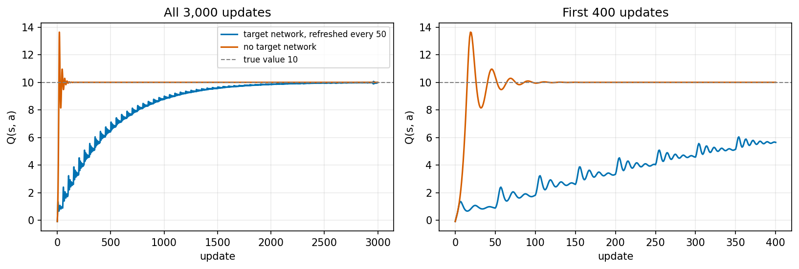
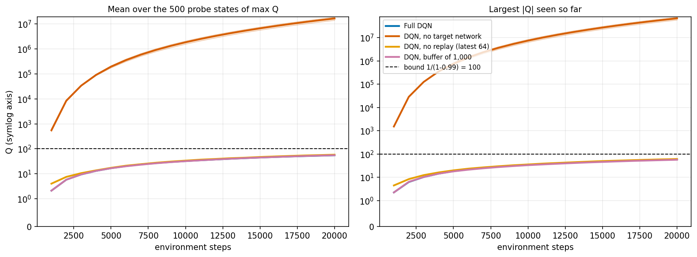
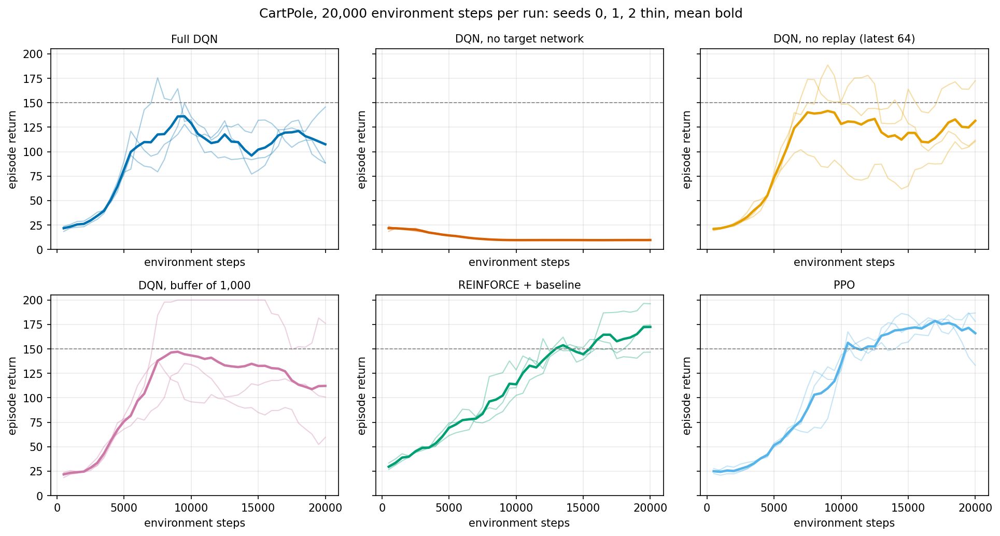

# Training an RL Agent

DQN, two broken versions of it, REINFORCE and PPO, written from scratch on CartPole with the same budget and three seeds each.

The task is the course CartPole. The state is four numbers (cart position and velocity, pole angle and angular velocity) and there are two actions (push left or right). Every step pays +1. An episode is terminated when the pole falls past 12 degrees or the cart leaves the track, and truncated when it reaches 200 steps, so the best possible return is 200. Those are different events, and the difference matters for the DQN target.

`lab09_starter.py` is the course starter, unchanged: the environment, the networks, the probe states and the curve helpers. Every agent gets exactly 20,000 environment steps on seeds 0, 1 and 2, and every learning curve, final return and "steps to 150" comes from the starter's `smooth_curve`, so all agents are measured the same way.

## Run

```bash
pip install -r requirements.txt
python lab09_starter.py          # check the unmodified starter runs
python Lab9.py                   # all five pieces, the figures and lab9_results.json
python Lab9.py checks            # or one piece: checks, dqn, ablations, policy_gradient, compare
```

`Lab9.ipynb` is the same code with its outputs and my notes, in five pieces:

1. The losses (DQN target, Huber, PPO clip, return-to-go, GAE), each checked against numbers I worked out by hand, plus a fixed-point test of the target network.
2. DQN on three seeds.
3. DQN with no target network, with no replay, and (extra) with a buffer of only 1,000.
4. REINFORCE with a baseline and PPO on the same budget.
5. All six agents compared under a rule I wrote down before looking at the table.

## Prediction (written before running piece 3)

I had already run pieces 1 and 2 (the checks and full DQN) when I wrote this, and I had not run any of the ablations. I had also test-run the policy-gradient code in a scratch copy to make sure it works, which does not bear on these predictions. Full DQN gave final returns of 88.7, 145.6 and 88.3 on seeds 0, 1 and 2. Only seed 2 reached a smoothed return of 150, at step 7,500 (seeds 0 and 1 never did), the mean over the probe states of the largest action value was 54.9, 54.7 and 55.8 at step 20,000, and the largest absolute Q I ever saw was 58.4, 58.1 and 61.1, all under the bound of 100.

**No target network.** I expect it to hurt a lot. I predict final returns of about 10 to 60 on every seed (I would not be surprised by a collapse to random-policy level, about 22), and that no seed reaches a smoothed return of 150. I predict the Q-values blow up: the mean largest action value and the largest absolute Q both pass 100 on all three seeds, probably between step 3,000 and step 10,000, and the largest absolute Q ever reaches somewhere between 1e3 and 1e6. The reason is that every update moves its own target. With weights shared across states, raising Q for one state raises Q for its neighbours, including the next states used in the target, and the max over actions picks whichever estimate is highest, so errors compound upward. Huber loss and the gradient clip at 10 limit how big one step is but not how far the drift can go over thousands of steps. I know the one-state fixed-point check shows no target network behaving fine, but that has no generalisation across states, which is what I think drives the blow-up.

**No replay (latest 64 transitions, target network kept).** I expect it to hurt, but less than removing the target network. I predict final returns of about 40 to 100, so on average maybe 30 to 60 points below full DQN, and "never" for steps to 150 on at least two of the three seeds. I predict the Q-values stay under 100 (mean largest action value somewhere between 30 and 70, largest absolute Q ever between 40 and 90), because the target network is still there and the bootstrapped values stay anchored, but I expect them to be noisier than for full DQN. The reason is that 64 consecutive steps are nearly the same trajectory, so each update fits one short stretch of the state space and undoes some of what the previous one learned. Each transition is still reused about 64 times, so I do not think the cost is lack of reuse, I think it is correlated, narrow data. I am less sure about this one than about the no-target run.

**Optional, a buffer of only 1,000 transitions.** I predict it lands close to full DQN, with final returns of about 60 to 130 and Q-values under 100, because 1,000 random samples from the last 1,000 steps are much less correlated than 64 consecutive ones and the target network is still there. I expect it to be a bit worse than full DQN because it forgets old states, for example the early part of an episode that it has learned to survive.

## Decision rule (written before looking at the table)

I count two configurations as different on a measure only if their three per-seed values do not overlap: every seed of one is strictly better than every seed of the other (for final return, the lowest of one above the highest of the other; for steps to 150 and wall-clock time, the slowest of one below the fastest of the other). A seed that never reaches 150 counts as slower than any seed that does; two seeds that never reach it are tied. Equal endpoints count as overlap. Anything else is "cannot tell". I apply it to all 15 pairs of the six agents on final return, steps to 150 and wall-clock time, and to the 6 pairs of DQN configurations on the largest |Q| ever seen. I say a configuration exceeds the bound of 100 only if all three seeds do. I will not change this rule after seeing the table.

**Against my prediction:**
- **No target network hurts a lot: right, and by more than I said.** Final returns of 9.6, 9.6 and 9.7, just under my 10 to 60. Q was already above 100 at the first reading (step 1,000) and its largest value reached 5.7e7 to 7.5e7, about two orders of magnitude above my top guess of 1e6.
- **No replay hurts: wrong.** Final returns of 111.7, 110.5 and 172.6 (mean 131.6, against 107.5 for full DQN), and two seeds reached 150. My Q prediction held: the largest Q stayed at 60 to 64, under 100.
- **Buffer of 1,000 lands near full DQN: partly right.** 100.8, 59.5 and 176.2, two of three inside my 60 to 130, with Q under 100.

## Results

Every number below is in `lab9_results.json`.

### Checks

| Check | Result |
|---|---|
| DQN target: terminal, non-terminal, time limit, both | 1.0, 7.3, 7.3, 1.0 as expected (only a real terminal stops the bootstrap) |
| Huber loss at 0.5, 3, -3 against PyTorch | 0.125, 2.5, 2.5, exact match |
| Fixed point (true value 10), with a target network | 9.98 after 3,000 updates, first within 0.1 at update 2,101 |
| Fixed point, without a target network | settled at 10.00 by about update 130, no blow-up |
| PPO clip at ratio 1.3 and 0.7, advantage ±1 | 1.2, -1.3, 0.7, -0.8, exact match |
| Return-to-go, rewards 1, 1, 1 at discount 0.5 | 1.75, 1.5, 1.0 |
| GAE at episode ends (extra) | truncated bootstraps, terminated doesn't, no leak across episodes |



The fixed point without a target network didn't diverge. A single state that bootstraps from itself just oscillates and settles, so this check can't show the instability DQN has across many states. What it does show is the cost of the target network: about 2,100 updates to converge instead of about 130.

### DQN and the ablations

| Setup | Final return (seeds 0 / 1 / 2) | Steps to 150 | Largest Q ever | Above 100? |
|---|---|---|---|---|
| Full DQN | 88.7 / 145.6 / 88.3 | never / never / 7,500 | 58.4 / 58.1 / 61.1 | no |
| No target network | 9.6 / 9.6 / 9.7 | never on all three | 5.68e7 / 7.47e7 / 7.03e7 | yes |
| No replay (latest 64) | 111.7 / 110.5 / 172.6 | 7,500 / never / 7,000 | 60.3 / 63.9 / 59.7 | no |
| Buffer of 1,000 (extra) | 100.8 / 59.5 / 176.2 | never / never / 7,500 | 57.6 / 58.0 / 55.6 | no |



Full DQN's Q-values stayed near 55 to 61, under the bound of 100 and under 86.6, the most a 200-step episode is worth. Only the no-target run broke the bound, on every seed. Its returns fell below the random policy's 22.2.

No replay didn't do what its name suggests. As the handout defines it (latest 64, one update per step), each transition is used about 64 times in a row, roughly the same reuse as full DQN (63.8 against 62.4 uses per transition). So this lab never tests data that's used once, and I didn't test why no replay held up.

### Policy gradient

| Agent | Final return (seeds 0 / 1 / 2) | Steps to 150 | Updates | Wall s |
|---|---|---|---|---|
| REINFORCE + baseline | 196.2 / 174.5 / 146.7 | 13,000 / 12,000 / 13,500 | 26 / 26 / 27 | about 4 |
| PPO | 133.2 / 186.7 / 178.2 | 10,500 / 10,500 / 11,000 | 912 each | about 10 |

Every DQN variant took about 24 s per run. PPO's ratio was exactly 1 (within 7e-7) on the first minibatch of every rollout and had moved off 1 by the last, with about 3% of samples clipped, so the old log-probabilities were kept properly.

### Comparison



Under the rule, two agents differ only if none of their seeds overlap. Out of the 15 pairs:

| Measure | Pairs that differ | Which |
|---|---|---|
| Final return | 6 | every other agent over no-target (5), and REINFORCE over full DQN (146.7 against 145.6) |
| Steps to 150 | 3 | REINFORCE and PPO over no-target, PPO over REINFORCE |
| Wall-clock | 12 | the 9 policy-gradient pairs, plus 3 DQN pairs about a second apart |

The 3 DQN wall-clock passes are differences of about a second on 24 s of identical work, and an earlier identical run flagged different pairs, so I treat them as timing noise. Everything else is "cannot tell".

## Conclusion

**Best final return:** REINFORCE with a baseline (196.2, 174.5, 146.7). It's the only agent that beats full DQN under my rule, but only by 1.1 on the closest seeds, it was the slowest to reach 150, and I can't separate it from PPO.

**Quickest to a working policy:** PPO, which reached 150 at steps 10,500 to 11,000 and beat REINFORCE on that measure. Its final return isn't clearly better than anything except the no-target DQN.

**Cheapest to run:** REINFORCE at about 4 s a run, then PPO at about 10 s, against about 24 s for every DQN variant, because DQN updates on every step.

**Full DQN:** I wouldn't pick it for this task. It only beat its own broken version. In its favour, it's the only agent whose Q-values I could check against a known bound, and it can reuse old data.

**What my numbers establish:**
- The target network matters: without it Q explodes and the agent does worse than random.
- The policy-gradient agents are several times cheaper per run than DQN here.

**What they don't establish:**
- An order among full DQN, no replay and the 1,000 buffer. Their seeds overlap on every measure.
- Why no replay held up, since it still reuses each transition about 64 times.

**Limits:**
- One small task, small networks, a fixed 20,000-step budget, three seeds and one set of settings I didn't tune per agent.
- Huber delta 1, PPO entropy coefficient 0 and PPO discount 0.99 were my choices; the handout doesn't give them.
- REINFORCE doesn't bootstrap at the 200-step limit, which is exactly what the DQN target is careful about.
- Q on the probe states is read every 1,000 steps, so a spike between readings would be missed.
